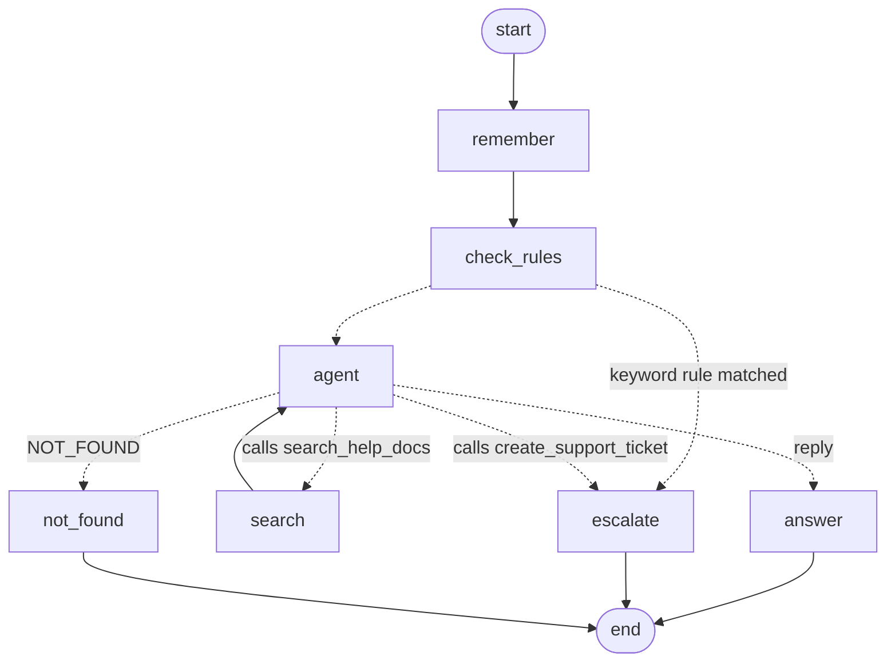

# AI Customer Support Agent

A support chatbot that answers customer questions **only from uploaded company documents** (RAG), cites its sources, and **hands off to a human** by creating a support ticket when it can't help, when the topic is out of scope, or when the customer asks for a person.

Stack: React (Vite) · FastAPI · LangGraph · Google Gemini · ChromaDB · SQLite

## Architecture

```
React (Vite, :5173)                      FastAPI (:8000)
┌─────────────────────┐   REST/JSON   ┌───────────────────────────────────────────────┐
│ Knowledge Base tab  │ ────────────► │ main.py        HTTP routes                    │
│ Chat tab            │               │ agent.py       LangGraph tool-calling agent   │
│ Tickets tab         │               │ kb.py          extract → chunk → embed/search │──► ChromaDB (backend/data/chroma)
└─────────────────────┘               │ escalation.py  keyword escalation rules       │      all-MiniLM-L6-v2 embeddings
                                      │ llm.py         Gemini reply + ticket summary  │──► Gemini API
                                      │ db.py          SQLite schema + helpers        │──► SQLite (backend/data/app.db)
                                      └───────────────────────────────────────────────┘
```

**Upload flow:** file → text extraction (pypdf / python-docx / utf-8) → ~700-char chunks with 100-char overlap (broken on whitespace) → embedded and stored in Chroma with the source filename → document marked `Processed` (or `Failed` with the error).

**Chat flow** is a tool-calling agent built as a LangGraph `StateGraph` (`backend/agent.py`), run once per customer message by `POST /chat/stream` (used by the UI) and `POST /chat` (same graph, not streamed). Gemini decides which tools to call; LangGraph runs them and loops back. This diagram is generated from the compiled graph (`agent.graph.get_graph().draw_mermaid()`):



1. **`remember`** loads the last 20 messages of the conversation from SQLite (the agent's memory), then saves the new message.
2. **`check_rules`** runs the keyword triggers (`escalation.py`) as a guardrail in front of the model, so billing, account and "talk to a person" messages always escalate, whatever the model would have done.
3. **`agent`** is one Gemini turn with two tools available. The model either replies (streamed to the chat as it's generated, via LangGraph's stream writer → JSON Lines) or calls a tool:
   - **`search_help_docs(query)`** → the **`search`** node runs it against Chroma (top 4 passages, below `MIN_SIMILARITY` dropped), sends the passages back, and the graph loops to `agent`. The model writes the query itself, so follow-ups become standalone searches ("can I return them?" after mentioning headphones → "What is the return policy for headphones?"), and it can search again with a different query if the first one finds nothing. At most 2 searches per message. While a search runs, the chat shows "Searching the help docs: …".
   - **`create_support_ticket(summary, category)`** → the **`escalate`** node. The model calls it when the customer asks for a ticket or a person, or accepts the offer of one, and writes the ticket's summary and category itself.
4. The model's reply decides the ending. The backend strips the `NOT_FOUND` marker and the trailing `SOURCES: …` line (`llm.parse_answer_stream`, unit-tested), so the customer only sees the reply:
   - **`answer`**: normal reply → streamed text + the source files it used (only files its searches actually returned).
   - **`not_found`**: `NOT_FOUND` (nothing in the docs or the conversation answers it) → honest "couldn't find that" + a **Create a support ticket** button. If the conversation already has an open ticket, it says the team can see the conversation there instead.

Company facts must come from search results; the conversation is used for follow-ups, things the customer said ("my name is…", "I bought headphones") and small talk, which need no search.

**Escalation** = create a ticket (one-line summary + category, written by the model in its tool call or by a separate summary call for keyword escalations; customer contact from the pre-chat form; status `Open`), link it to the conversation, mark the conversation `escalated`, log a simulated email, and tell the customer the ticket ID.

## Setup

Prerequisites: Python 3.10+, Node 20.19+ or 22.12+ (required by Vite 7), a free Gemini API key from https://aistudio.google.com/apikey.

```bash
# 1. Environment
cp .env.example .env          # then put your key in GEMINI_API_KEY

# 2. Backend (from the project root)
python -m venv .venv
.venv\Scripts\activate         # Windows   (macOS/Linux: source .venv/bin/activate)
pip install -r requirements.txt
cd backend
uvicorn main:app --reload      # http://localhost:8000, API docs at http://localhost:8000/docs

# 3. Frontend (second terminal)
cd frontend
npm install
npm run dev                    # http://localhost:5173
```

The first upload downloads the ~80 MB embedding model once (to `~/.cache/chroma`).
If `GEMINI_API_KEY` is missing, the backend refuses to start and prints how to fix it.

**Try it:** upload `samples/Return_Policy.txt` and `samples/FAQ.txt` in the Knowledge Base tab. In Chat, ask *"How long do I have to return an item?"*, then *"I was charged twice for my last order and need a refund now."*, then open the Tickets tab.

**Tests:** `cd backend && pytest` (chunking, escalation rules, stream parsing, and the agent graph with Gemini scripted: search loop, not found, model-created ticket, keyword guardrail and the search limit; no API key or network needed).

### Run with Docker (alternative)
One container serves the API and the built React app on port 8000:

```bash
cp .env.example .env          # then put your key in GEMINI_API_KEY
docker compose up --build
```

Open http://localhost:8000 (API docs at http://localhost:8000/docs). Compose passes the key from `.env` to the container and keeps documents, chats and tickets in the `support-data` volume. The image itself never contains `.env` (see `.dockerignore`), so starting it without the key, for example with Docker Desktop's Run button, stops with "GEMINI_API_KEY is not set". Without Compose: `docker build -t support-agent .`, then `docker run -p 8000:8000 --env-file .env -v support-data:/app/backend/data support-agent` (the key must be unquoted there, because `--env-file` keeps quotes). The embedding model is downloaded during the build.

### Deploy on Render
Create a web service from this repo with **Language: Docker**, leaving Root Directory, Build Command and Start Command empty (the Dockerfile builds everything and listens on Render's `PORT`), and add `GEMINI_API_KEY` under Environment. Tested in Docker with the free plan's limits (512 MB RAM, 0.1 CPU): it starts listening in ~30 s, and uploading a sample document and asking a question peaked at ~480 MB. The free plan has no persistent disk, so documents, chats and tickets are wiped whenever the service restarts, redeploys or sleeps after 15 idle minutes. Upload the samples again after a cold start.

### Environment variables
| Variable | Required | Purpose |
|---|---|---|
| `GEMINI_API_KEY` | yes | Gemini API key |
| `GEMINI_MODEL` | no | Model name, default `gemini-flash-latest` |
| `GEMINI_THINKING_LEVEL` | no | Default `low` (first streamed token ~2s instead of ~10s on Gemini 3). Set it empty for Gemini 2.5 models, which reject it |
| `VITE_API_URL` | no (frontend) | Backend URL. Default: `http://localhost:8000` in dev; a production build (Docker) calls the server it was loaded from |

## API

Full interactive docs: **http://localhost:8000/docs** (FastAPI/OpenAPI).

| Method | Route | Purpose |
|---|---|---|
| POST | `/kb/upload` | Upload PDF/TXT/DOCX (multipart `file`); extract, chunk, embed, store |
| GET | `/kb/documents` | List documents with upload date, status, chunk count |
| POST | `/conversations` | Start a conversation `{name, email}` (contact info used for tickets) |
| GET | `/conversations/{id}` | Conversation + full message history (restores chat after reload) |
| POST | `/chat` | `{conversation_id, message}` → `{reply, sources, escalated, ticket_id, offer_ticket}` |
| POST | `/chat/stream` | Same input. Streams JSON Lines: `{"type":"status","text"}` while the agent searches, `{"type":"token","text"}` reply pieces, then one `{"type":"done", …same fields as /chat}` or `{"type":"error","detail"}` |
| POST | `/tickets` | `{conversation_id, summary?, category?}` create a ticket (also used by the chat button) |
| GET | `/tickets` | List tickets |
| GET | `/tickets/{id}` | Ticket + linked conversation messages |
| PATCH | `/tickets/{id}` | `{status: "Open" \| "In Progress" \| "Resolved"}` |

Errors return proper status codes with a readable `detail`: 400 unsupported file type, 413 file over 10 MB, 422 empty/unreadable document or invalid input, 404 unknown id, 503 LLM unavailable.

## Choices and why

- **LLM: Google Gemini (`gemini-flash-latest`)**, via the official `google-genai` SDK. Free tier, fast, supports streaming. Answers stream as plain text with two small markers (`NOT_FOUND`, `SOURCES:`) rather than JSON, because half-written JSON can't be shown to the customer. Ticket summaries don't stream, so they use structured JSON output validated by a Pydantic model.
- **Agent: tool calling, orchestrated by LangGraph** (`StateGraph`). Gemini decides when and what to search and when to open a ticket; the graph makes those decisions visible (see the diagram above) and keeps the parts that must be reliable outside the model: the keyword guardrail, the 2-search limit, source checking, and the fixed wording of ticket confirmations. Adding a capability, such as an order-lookup tool, means one function declaration plus one node. Deliberate choices:
  - **Function calling through Gemini's own SDK, no LangChain model wrappers.** The SDK's automatic function calling is turned off so LangGraph nodes run the tools. Each model turn is sent back whole, which keeps Gemini 3's thought signatures (required for multi-step tool use). Tool results go back as a `user` turn, because the API rejects the `tool` role.
  - **No LangGraph checkpointer for memory:** the conversation already lives in SQLite, because the UI and the tickets need it. A checkpointer would be a second copy that could disagree with it, so `remember` loads memory from SQLite instead.
  - **Trade-off:** questions about the docs take two model calls (search, then answer), so the first text arrives after about 4–6 s instead of 2–3 s. The live "Searching the help docs…" status covers the wait. Small talk and memory questions stay at one call.
- **Streaming transport: JSON Lines over a normal POST** (FastAPI `StreamingResponse`, read in the browser with `fetch` + `ReadableStream`). Simpler than WebSockets, and unlike `EventSource`/SSE it allows a POST body. Validation and unknown-conversation errors are still normal 4xx responses, because they're checked before streaming starts. Failures mid-stream arrive as an `error` event.
- **Embeddings: `all-MiniLM-L6-v2`**, run locally through ChromaDB's built-in ONNX `DefaultEmbeddingFunction`. Free, no rate limits, no network call per query, and no PyTorch install.
- **Vector store: ChromaDB** (embedded, persisted to `backend/data/chroma`), cosine distance. Similarity is `1 - distance`.
- **Database: SQLite** via Python's built-in `sqlite3` with plain SQL (4 tables: documents, conversations, messages, tickets). No ORM to keep it easy to read.

## Escalation triggers

Explicit keyword rules (`backend/escalation.py`, unit-tested) run before the LLM; the LLM adds the conversational ones:

| Trigger | Example | Result |
|---|---|---|
| Customer asks for a person / says it didn't help | "talk to a human", "that didn't help" | ticket, category chosen by LLM summary |
| Billing | "charged twice", "overcharged", "payment failed" | ticket, billing |
| Account access | "locked out", "can't log in", "hacked" | ticket, account |
| Complaint / frustrated language | "complaint", "unacceptable", "ridiculous", "furious" | ticket, complaint |
| Nothing in the docs answers it (LLM `NOT_FOUND`) | "what products do you sell?", "who won the football match?" | customer is **offered** a ticket |
| Model calls `create_support_ticket` (customer asked for a ticket, or accepted the offer) | "yes please", "can you open a ticket? it arrived damaged" | ticket, summary and category written by the model |

Why:
- `refund` and `return` are deliberately **not** triggers, so "what's your refund policy?" is still answered from the docs. Only account-specific money problems escalate.
- Unanswerable questions are offered a ticket rather than having one forced on them, and "yes" to that offer is understood because the model sees the conversation.
- The similarity threshold (0.10) only decides which passages are sent to Gemini. Measured on the sample docs with all-MiniLM-L6-v2, specific questions scored 0.37–0.72, broad but on-topic ones ("what are company policies") 0.15–0.17, and off-topic ones 0.07–0.09.
- An earlier version skipped Gemini entirely below the threshold (bonus 9.d). It was removed because conversational messages ("yes", "thanks", "who are you", "what's my name?") always score low against the docs, so that shortcut escalated or refused them without ever looking at the conversation.
- Sources shown are the files Gemini says it used, filtered to files that were actually retrieved, so the bot can't cite a document that doesn't exist.
- A conversation never gets duplicate tickets: further triggers point to the existing open ticket. A new one can be created after it's marked Resolved.
- Ticket creation never fails because of the LLM: if Gemini is down, the summary falls back to the customer's last message.

## Design decisions and trade-offs

- **Synchronous ingestion.** Upload processes the file in the request (seconds for typical docs). Simpler than a job queue, but a very large PDF blocks that request. The status column still records Processing/Processed/Failed.
- **Pre-chat form for contact info.** Name and email are collected once up front (like Intercom's pre-chat form), so a ticket always has valid contact details and escalation needs no extra back-and-forth.
- **Conversation memory:** the last 20 messages are sent with every request as a transcript. The model uses them to recall facts ("what's my ticket number?") and to turn follow-ups into standalone search queries. The cap keeps very long chats from growing the prompt without limit.
- **Conversation id in localStorage** + messages in SQLite: reloads and server restarts restore the chat. Sources and ticket banners are stored per message, so they re-render too.
- **Sync FastAPI endpoints** (run in FastAPI's thread pool), because the Gemini SDK call and Chroma are blocking. Simpler than mixing async and sync clients.

## Bonus items done
Streamed responses · DOCX upload · conversation memory and follow-up context · ticket status workflow (dropdown on the Tickets page) · simulated email notification (logged by the backend) · keyword-based frustration detection · unit tests · 10 MB upload limit with 413 + validation with proper status codes · Dockerfile (one container for the API and the built UI).

## Known limitations / with more time
- No authentication. Anyone can view all tickets and upload documents.
- No document delete or re-index. Uploading the same file twice duplicates its chunks.
- Keyword triggers are English-only and can miss paraphrases. An LLM intent classifier would be more robust, at the cost of an extra call per message.
- Scanned (image-only) PDFs are rejected because there's no OCR.
- If the customer closes the tab mid-answer, the partial answer isn't saved (their question is).
- No re-ranking or hybrid keyword+vector search.
- Memory covers the last 20 messages of the current conversation only; it doesn't carry over to a new conversation.
- Every message costs at least one Gemini call, and questions about the docs two or three (search, maybe a second search, then answer). There's no similarity shortcut any more, see above.
- Grounding relies on the model calling the search tool before stating company facts (instructed, and sources are only shown from real search results); a model that answered from its own knowledge without searching wouldn't be caught automatically.
- On Render's free plan, data resets on every restart, redeploy or sleep (no persistent disk), and memory peaks near the 512 MB limit, so large uploads may not fit there.
